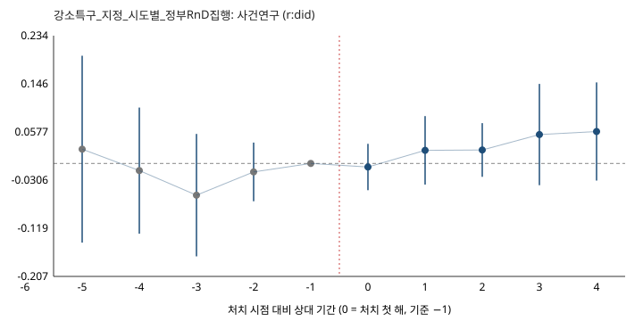

# 강소특구_지정_시도별_정부RnD집행 — 추정 결과 보고

- 질문: 강소연구개발특구를 처음 지정받은 시도의 정부 R&D 집행액(log)이, 아직 지정받지 않은 시도와 비교해 지정 후 0~3년에 달라졌는가
- 처치: 강소연구개발특구 지정(시도 안 첫 지정 연도) · 방법: cs (r:did 2.1.2)
- 자료: `panel.csv` (sha 3706a58e008b6905) · 결과변수 `exec_100m_krw` (KOSIS DT_127003_009 지역별 국가연구개발사업 집행 추이(억원, 집행연도 기준), kr-sti-data export 2026-10-20)
- 설계서 sha b5e9e785f6a802d0 · 게이트 WARN (2026-10-20T21:16:43) · 추정 2026-10-20T21:16:57
- 비교군: notyettreated · 단위 16 · 사건창 [-5, 4]

## 1. 추정표

| 추정량 | 추정치 | 표준오차 | 95% 구간 | 단위 |
|---|---|---|---|---|
| 전체 ATT | 0.0299 | 0.0187 | [-0.00676, 0.0665] | log 차이(≈비율 변화) |

| 상대 기간 | ATT | SE | 95% 구간 |
|---|---|---|---|
| -5 | 0.0261 | 0.0874 | [-0.145, 0.197] |
| -4 | -0.0132 | 0.059 | [-0.129, 0.103] |
| -3 | -0.0582 | 0.0573 | [-0.17, 0.054] |
| -2 | -0.0155 | 0.0275 | [-0.0693, 0.0383] |
| -1 | 0 | — | — |
| +0 | -0.00655 | 0.0217 | [-0.049, 0.0359] |
| +1 | 0.024 | 0.032 | [-0.0388, 0.0867] |
| +2 | 0.0246 | 0.0251 | [-0.0245, 0.0738] |
| +3 | 0.0529 | 0.0474 | [-0.0399, 0.146] |
| +4 | 0.0585 | 0.0459 | [-0.0315, 0.149] |



| 코호트 | ATT | SE |
|---|---|---|
| 2019 | 0.00925 | 0.0222 |
| 2020 | 0.0467 | 0.0291 |
| 2022 | 0.0551 | 0.0376 |

## 2. 사전 등록 가설별 판정

| 가설 | 등록 방향 | 관측 | 판정 |
|---|---|---|---|
| H1 지정 후 0~3년 시도 정부 R&D 집행액(log)이 증가한다. 단 강소특구 국비는 특구당 연 수십억 원 규모라 시도 집행액(수천~수만억 원) 대비 효과가 작아 검출되지 않을 가능성이 크다 | positive | horizon [0, 3]: 평균 0.0237 (4기) | 방향 일치 (구간이 0을 포함) · 클러스터 수 부족으로 유의성 언급 보류 |

## 3. 말할 수 있는 것

- 이 추정치는 **강소연구개발특구 지정(시도 안 첫 지정 연도)** 를 받은 단위의 `exec_100m_krw` 가, 아직 처치되지 않은 단위(미처치 포함)와 비교해 처치 전 차이를 유지했을 때(평행추세)보다 얼마나 달라졌는가이다.
- 말할 수 있는 범위는 설계서에 등록한 가설 H1 의 결과변수·horizon 안이다. 다른 결과변수·다른 기간에 대한 해석은 이 보고서에 없다.
- 처치 전 상대 기간(-5, -4, -3, -2)의 추정치는 평행추세의 '관측 가능한 부분'에 대한 점검이며, 0에 가까워도 가정의 증명은 아니다.
- 단위가 'unit' 이므로 효과는 그 단위 수준의 평균이다. 하위 단위(개별 과제·연구자·기관)의 효과로 옮기지 않는다.

## 4. 말할 수 없는 것 · 주의 (게이트에서 그대로 옮김)

- [G2g WARN] 자료 출처의 단절 각주: 시계열 단절 2024: R&D 예산 기준 변경 — 약 1.8조원이 R&D→非R&D로 재분류되어 2023↔2024 증감률 단순 비교 주의(KISTEP 2026년도 정부연구개발예산 현황분석)
- [G4 WARN] 클러스터 16개로 기준(20)에 못 미침 — 신뢰구간이 과소 추정될 수 있어 유의성 언어를 쓰지 않는다
- [G4b WARN] 단위 1개 코호트(2022)의 효과는 그 단위의 특이 충격과 구분되지 않는다
- [G4d WARN] 코호트 2022는 처치 후 2기까지만 관측돼 horizon 3까지 말할 수 없다
- [G6 WARN] 파급 가능성(medium): 강소특구는 시·군 단위이고 시도 집행액은 그 시도 전체 합이라 특구 밖으로의 파급이 같은 시도 안에 머물면 단위 안에 흡수된다. 시도 간 사업 이동(기관 이전·다부처 사업)은 배제할 수 없다
- [G2c] 불균형 패널 — 단위 진입·퇴출이 처치와 무관한지 확인 필요
- [G2f] exclude_units 사유로 제외한 단위: 강원특별자치도
- [G5] 사전 추세 검정 통과는 평행추세 가정의 증명이 아니다(검정력 한계, Roth 2022)
- 추정치는 등록한 비교군·사건창·가정 아래의 값이며, 설계서를 바꾸면 다시 게이트부터 돈다(설계서·자료 해시가 보고서 머리에 있다).

## 5. 재현

```bash
python3 policy_did.py check design.yaml --data panel.csv --out out
python3 policy_did.py estimate design.yaml --data panel.csv --out out
python3 policy_did.py report design.yaml --data panel.csv --out out
```
