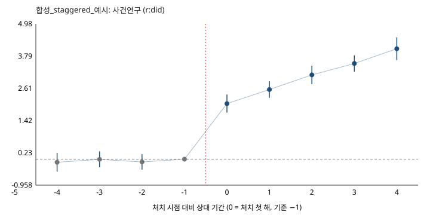

# 합성_staggered_예시 — 추정 결과 보고

- 질문: 합성 자료: 처치가 y를 effect만큼 올리는가(참값 2.0 + 0.5/년)
- 처치: 제도 X · 방법: cs (r:did 2.1.2)
- 자료: `panel.csv` (sha 263223deeee599e3) · 결과변수 `y` (출처(표 ID·조회일)를 적는다)
- 설계서 sha 67b4274aa9de6860 · 게이트 PASS (2026-10-20T21:05:26) · 추정 2026-10-20T21:05:31
- 비교군: notyettreated · 단위 60 · 사건창 [-4, 4]

## 1. 추정표

| 추정량 | 추정치 | 표준오차 | 95% 구간 | 단위 |
|---|---|---|---|---|
| 전체 ATT | 3.75 | 0.152 | [3.46, 4.05] | 'y' 단위 |

| 상대 기간 | ATT | SE | 95% 구간 |
|---|---|---|---|
| -4 | -0.116 | 0.177 | [-0.463, 0.231] |
| -3 | -0.00849 | 0.151 | [-0.304, 0.287] |
| -2 | -0.104 | 0.147 | [-0.391, 0.183] |
| -1 | 0 | — | — |
| +0 | 2.05 | 0.17 | [1.71, 2.38] |
| +1 | 2.56 | 0.155 | [2.26, 2.87] |
| +2 | 3.1 | 0.173 | [2.77, 3.44] |
| +3 | 3.52 | 0.153 | [3.22, 3.82] |
| +4 | 4.07 | 0.214 | [3.65, 4.49] |



| 코호트 | ATT | SE |
|---|---|---|
| 2015 | 4.21 | 0.201 |
| 2018 | 3.66 | 0.254 |
| 2021 | 2.79 | 0.27 |

## 2. 사전 등록 가설별 판정

| 가설 | 등록 방향 | 관측 | 판정 |
|---|---|---|---|
| H1 처치 후 0~3기에 y가 증가한다(참값 양) | positive | horizon [0, 3]: 평균 2.81 (4기) | 방향 일치 |

## 3. 말할 수 있는 것

- 이 추정치는 **제도 X** 를 받은 단위의 `y` 가, 아직 처치되지 않은 단위(미처치 포함)와 비교해 처치 전 차이를 유지했을 때(평행추세)보다 얼마나 달라졌는가이다.
- 말할 수 있는 범위는 설계서에 등록한 가설 H1 의 결과변수·horizon 안이다. 다른 결과변수·다른 기간에 대한 해석은 이 보고서에 없다.
- 처치 전 상대 기간(-4, -3, -2)의 추정치는 평행추세의 '관측 가능한 부분'에 대한 점검이며, 0에 가까워도 가정의 증명은 아니다.
- 단위가 'unit' 이므로 효과는 그 단위 수준의 평균이다. 하위 단위(개별 과제·연구자·기관)의 효과로 옮기지 않는다.

## 4. 말할 수 없는 것 · 주의 (게이트에서 그대로 옮김)

- 게이트 WARN 항목 없음.
- [G5] 사전 추세 검정 통과는 평행추세 가정의 증명이 아니다(검정력 한계, Roth 2022)
- 추정치는 등록한 비교군·사건창·가정 아래의 값이며, 설계서를 바꾸면 다시 게이트부터 돈다(설계서·자료 해시가 보고서 머리에 있다).

## 5. 재현

```bash
python3 policy_did.py check design.yaml --data panel.csv --out out
python3 policy_did.py estimate design.yaml --data panel.csv --out out
python3 policy_did.py report design.yaml --data panel.csv --out out
```
